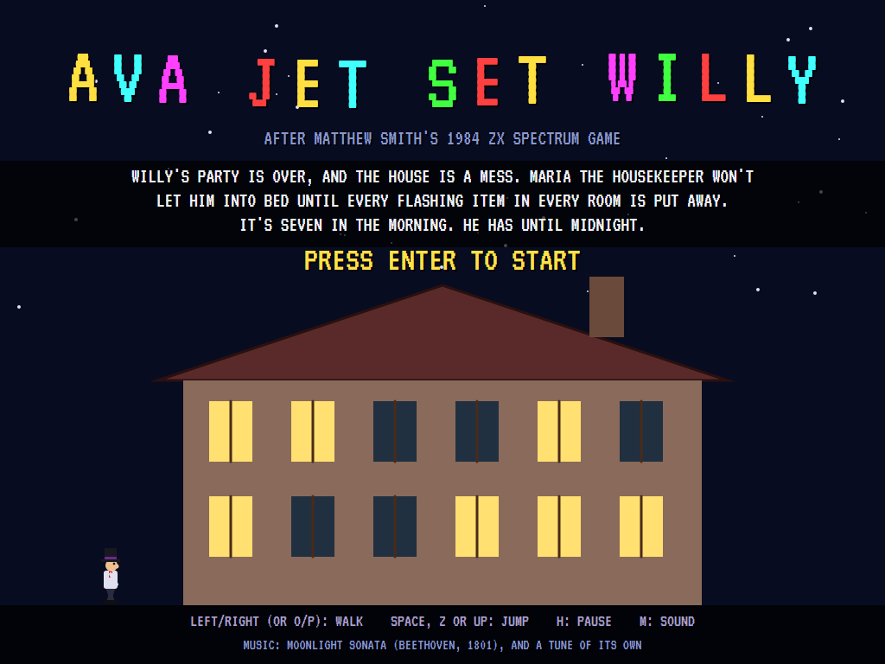
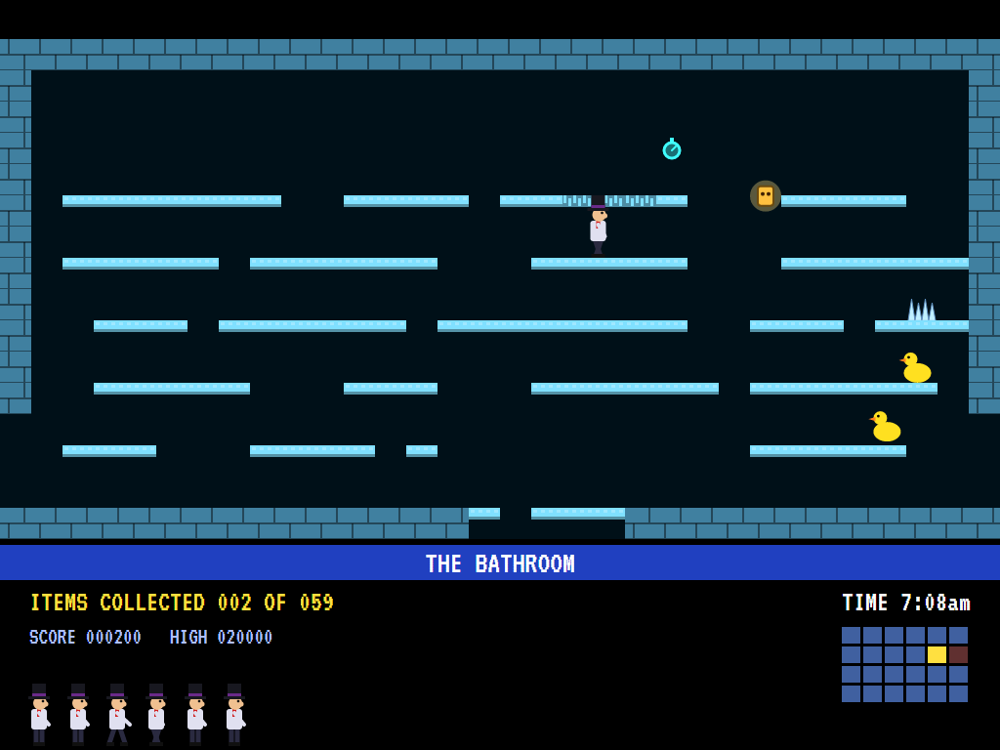
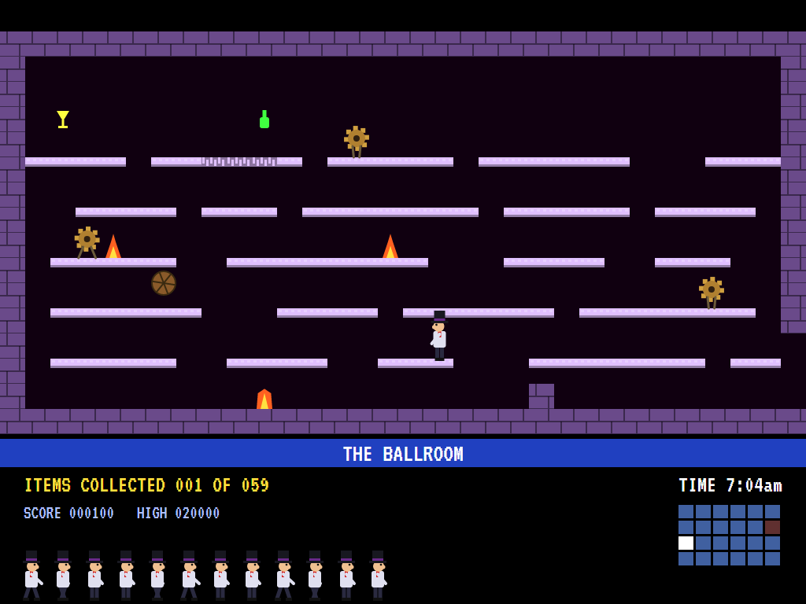
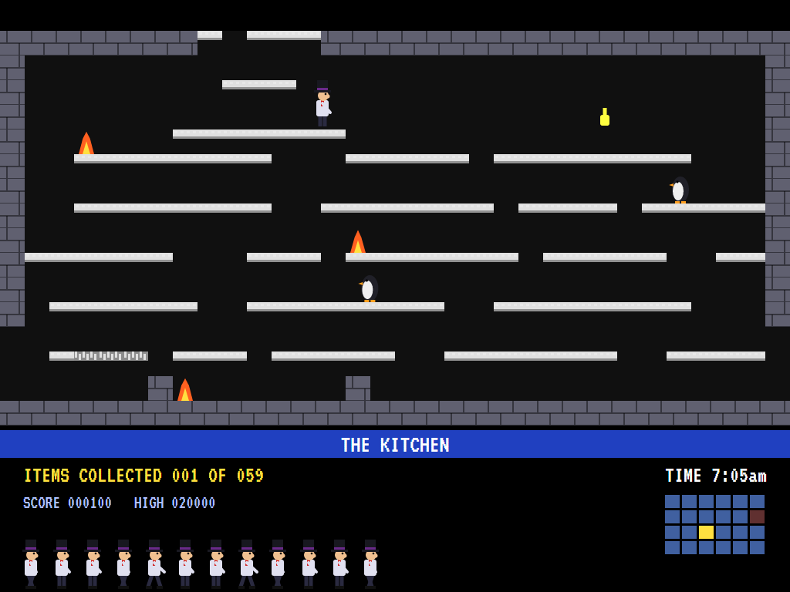
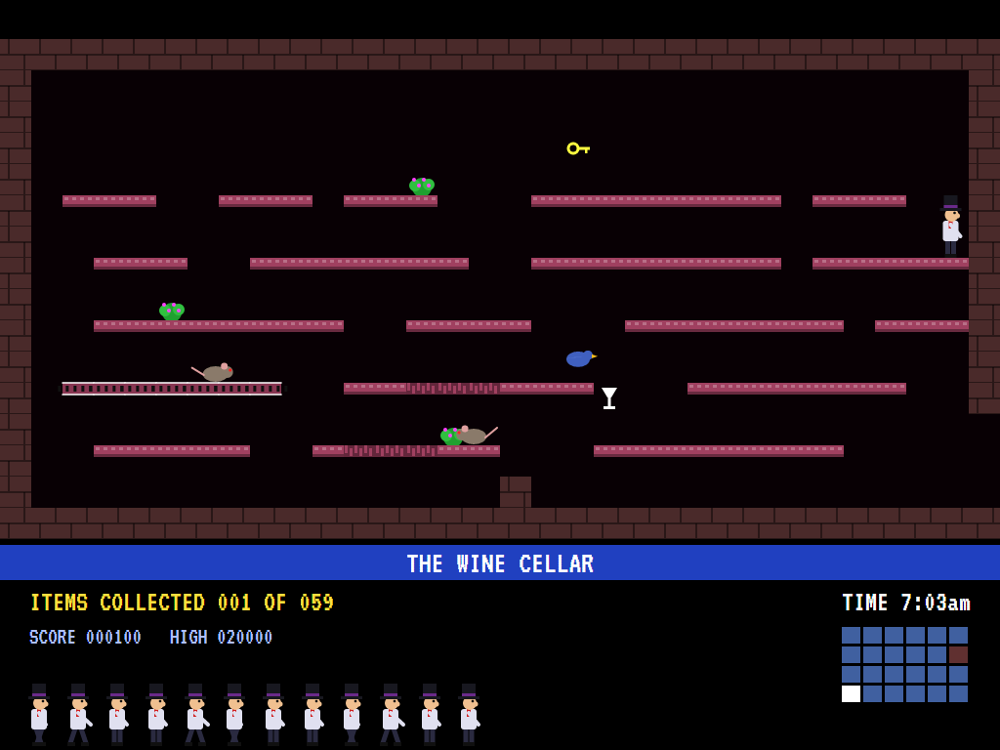
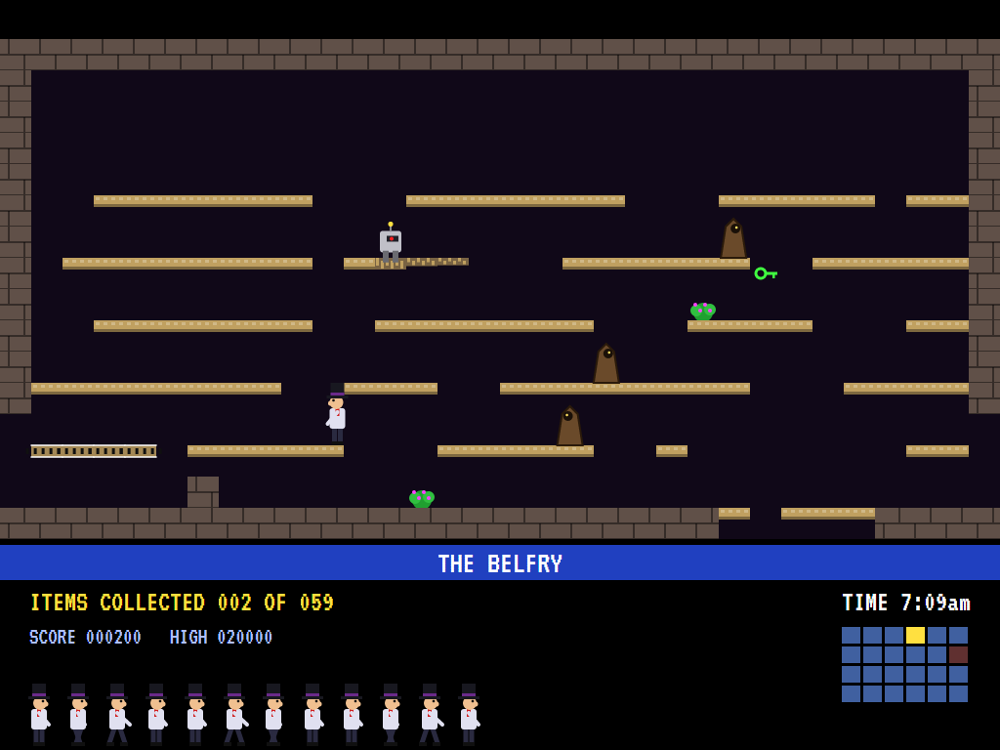
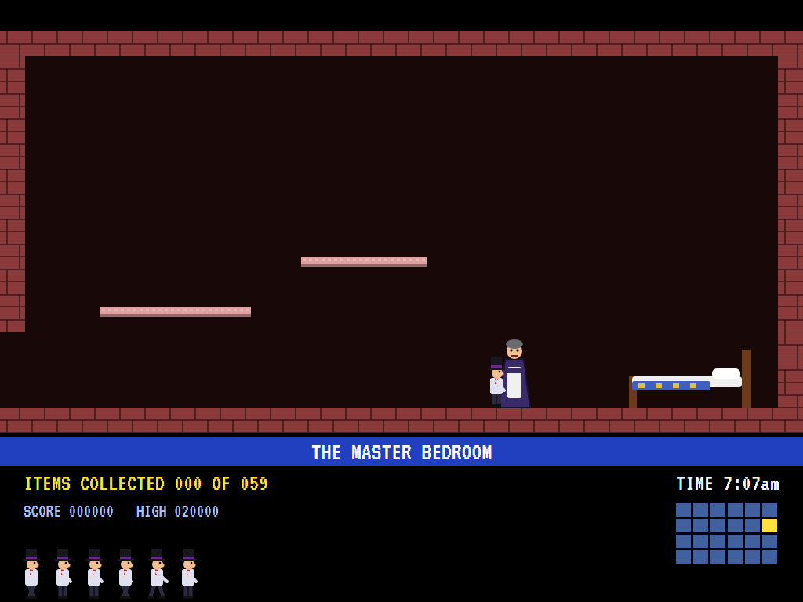
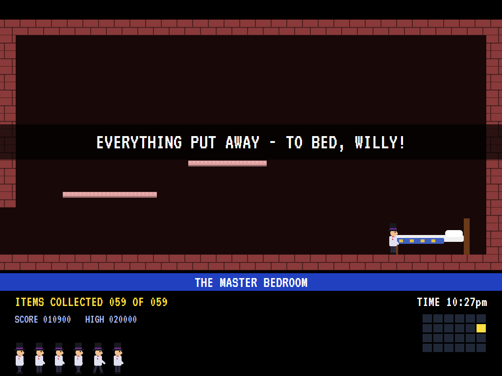
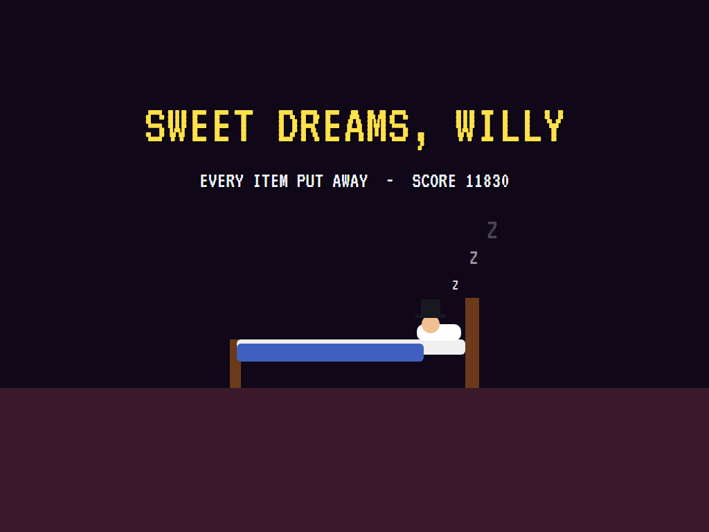
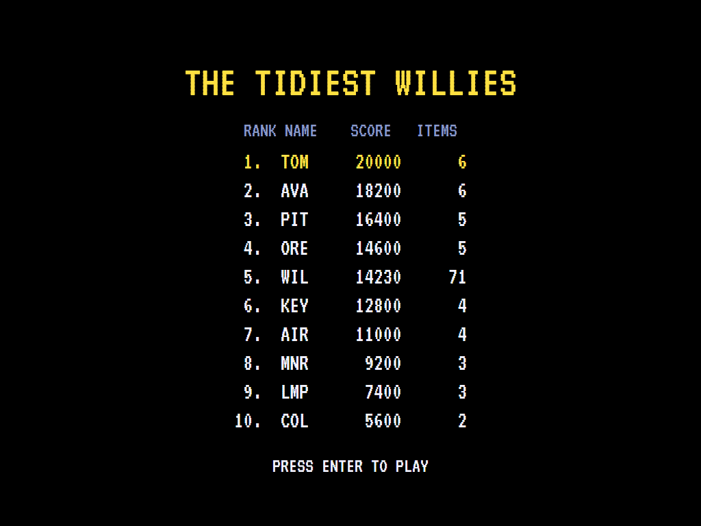

# AVA Jet Set Willy

[](https://github.com/Harlock123/AVAJetSetWilly/actions/workflows/build.yml)

A flip-screen platform game round a mansion, in the style of Matthew Smith's 1984 ZX Spectrum game **Jet Set
Willy**. It's built with .NET 10 and Avalonia UI. Willy's party is over and the house is a mess. Maria the
housekeeper won't let him into bed until every flashing item in every room is put away. It's seven in the
morning, and he has until midnight.

## Features

- **A mansion of 24 rooms**, six across and four floors high: the roof, the bedrooms, the ground floor and
  the cellars. Doorways in the side walls lead from room to room. Gaps in the floors join each floor to the
  next: drop through to go down, or jump up through from the ledge beneath to go up.
- **Every room is built from its own seed, then proved passable.** Each candidate layout is mapped by
  trying every walk and jump in the game's own physics. It's kept only if every way in, every way out and
  every item can be reached from every other, guardians or not.
- **The platforming you'd expect:** a fixed jump arc, ledges you can jump up through, conveyors, crumbling
  ledges, nasties, and guardians on their beats. A fall of more than four squares is fatal.
- **59 items** to collect, each something about the house: taps, glasses, keys, bells, watches, bottles.
- **The clock:** from 7:00am to midnight, chiming the hours. Get to bed and the time to spare counts into
  the score.
- **Maria** stands guard in the master bedroom. Once everything is put away, she's gone, and Willy can get
  to bed.
- **Lives:** lose one and Willy comes back where he first stood in that room, so a bad entry never traps
  him.
- **A map** of the house on the panel shows which rooms still have something in them.
- **The attract mode** shows the computer Willy at work. It finds the nearest room with something left in
  it, plans its way there through the doorways and gaps, and clears it. Before each move it plays the move
  out on a copy of the house, guardians and all, and waits for its moment. If a crumbled ledge cuts it off,
  it steps out of the room and back in to find the room as it was. Then it goes to bed.

## Screenshots

| The title | The bathroom | A jump |
|:---------:|:------------:|:------:|
|  |  |  |
| The house at night. | Where Willy starts. | In the ballroom. |

| The kitchen | The wine cellar | The belfry |
|:-----------:|:---------------:|:----------:|
|  |  |  |
| Ground floor. | Down below. | Up on the roof. |

| Maria | To bed | Sweet dreams |
|:-----:|:------:|:------------:|
|  |  |  |
| Not till it's all put away. | Everything collected. | The end of a good game. |

| Game over | The tidiest Willies |
|:---------:|:-------------------:|
|  |  |

The screenshots are made by the tests, which play the game in a real (headless) window; see
[Tests](#tests).

## Download and run

Ready-to-run builds for Windows, macOS and Linux, on both Intel/AMD and ARM, are on the
[Releases page](https://github.com/Harlock123/AVAJetSetWilly/releases/tag/latest). **Latest build** is
rebuilt on every push to `main`. Each download is one self-contained executable: no .NET install is
needed.

| Platform | Archive |
|---|---|
| Windows | `AVAJetSetWilly-win-x64.zip`, `AVAJetSetWilly-win-x86.zip`, `AVAJetSetWilly-win-arm64.zip` |
| macOS | `AVAJetSetWilly-osx-arm64.tar.gz` (Apple silicon), `AVAJetSetWilly-osx-x64.tar.gz` (Intel) |
| Linux | `AVAJetSetWilly-linux-x64.tar.gz`, `AVAJetSetWilly-linux-arm64.tar.gz`, `AVAJetSetWilly-linux-arm.tar.gz` |

```bash
tar -xzf AVAJetSetWilly-linux-x64.tar.gz     # or linux-arm64, linux-arm, osx-arm64, osx-x64
./AVAJetSetWilly
```

On Windows, unzip and run `AVAJetSetWilly.exe`. On macOS, if Gatekeeper refuses to open it, run
`xattr -d com.apple.quarantine AVAJetSetWilly` once. Run with `--no-audio` for silence.

**Sound** comes through OpenAL Soft, built in for every platform. In a virtual machine the game
detects it and uses a larger audio buffer, so the sound doesn't break up.

**Gamepads** use SDL2, which is bundled for Windows, macOS and Intel/AMD Linux. ARM Linux builds need it
installed; without it the keyboard still works:

```bash
sudo apt install libsdl2-dev            # Debian / Ubuntu / Raspberry Pi OS
sudo pacman -S --needed sdl2-compat     # Arch / Omarchy
```
## Controls

| Action | Keyboard | Gamepad |
|---|---|---|
| Start | Enter or 1 | Start |
| Walk | Left/right arrows, O/P or A/D | Left stick / D-pad |
| Jump | Space, Z, X, W or Up | A, B, X or up |
| Pause | H or Esc | Start or Back |
| Sound on/off | M | |
| Screenshot | Ctrl+S (to your Pictures folder) | |

On the high-score table, type your initials, or use up/down and Space, then Enter.

## Tests

```bash
dotnet test AVAJetSetWilly.slnx
```

The game runs in fixed 60 Hz steps, so it plays the same at any frame rate. Everything that moves lives in
one world that can be copied. The tests check:

- **The house:** six rooms across and four floors, with doorways between neighbours; every floor joined to
  the next by a gap that matches on both sides; two or three items in every room but the master bedroom;
  every way and item in every room reachable from every other; the bathroom and the bed where they
  belong; a name for every room.
- **Walking and jumping:** a steady pace; a fixed arc; jumping up through a ledge; a short drop survived and
  a long one not; conveyors and crumbling ledges; nasties and guardians.
- **The house in play:** through a doorway and back; a wall with no doorway; down through a gap and up
  again; collecting an item; coming back after a death where he first stood; Maria barring the way until
  everything is collected; the clock.
- **The game:** lives, and the last one; midnight; into bed, with the bonus and the time to spare, then the
  high scores; the demonstration; pause; the keys.

`tests/AVAJetSetWilly.Tests/PilotProbe.cs` plays the computer Willy round the whole house, for tuning
(`WILLY_PROBE=1`). It collects all 59 items and goes to bed with time to spare and no lives lost.
`WILLY_PROBE=lazy` walks right and jumps now and then: it collects two items before midnight.

The screenshot tests draw the real screen in a headless window. To refresh the README's pictures:

```bash
WILLY_SHOTS=$PWD/Images dotnet test tests/AVAJetSetWilly.Tests --filter ScreenshotTests
```

## Building

```bash
dotnet build AVAJetSetWilly.slnx
dotnet run --project src/AVAJetSetWilly
```

Needs the .NET 10 SDK. The sounds and tunes are made by `tools/make_sounds.py` (standard-library Python,
with the formant voice in `tools/speech.py`): `python3 tools/make_sounds.py` rewrites
`src/AVAJetSetWilly/Sounds`. The title plays the opening of Beethoven's *Moonlight Sonata* (1801, in the
public domain); the tune about the house is a new composition.

## Project structure

```
AVAJetSetWilly/
├── AVAJetSetWilly.slnx
├── src/AVAJetSetWilly/
│   ├── Engine/
│   │   ├── GameEngine.cs        # States, lives, the clock, bedtime, the title and demonstration
│   │   ├── Sim.cs               # The house step by step: walking, jumping, rooms, items, Maria
│   │   ├── World.cs             # Everything that moves or changes, kept together so it can be copied
│   │   ├── Mansion.cs           # The rooms, built from seeds and proved passable, and the items
│   │   ├── Graph.cs             # Every standing place in a room and where each move takes him
│   │   ├── Pilot.cs             # The computer Willy (the demonstration, and the tests)
│   │   ├── HighScoreTable.cs, InitialsEntry.cs
│   │   ├── InputHandler.cs, ControllerManager.cs  # Keys and an SDL2 gamepad
│   │   └── SoundManager.cs      # Effects and tunes through OpenAL
│   ├── Audio/                   # The OpenAL engine (from the author's AVABand)
│   ├── Views/GameCanvas*.cs     # The rooms, Willy, Maria, the panel and map, the title
│   └── Sounds/                  # The synthesised effects and tunes
├── tests/AVAJetSetWilly.Tests/  # House, gameplay and screenshot tests
├── tools/make_sounds.py, tools/speech.py
└── Images/                      # Screenshots
```

## About and licence

AVA Jet Set Willy © 2026 Lonnie Watson, under the [MIT License](LICENSE).

*Jet Set Willy* © 1984 Software Projects (written by Matthew Smith); the names *Jet Set Willy*, *Willy* and
*Maria* belong to their current owner. AVA Jet Set Willy is an independent, unofficial game in its style.
Its house, graphics, sounds and code are its own; nothing is taken from the original game's program,
graphics or sound. It is not affiliated with or endorsed by any rights holder.
